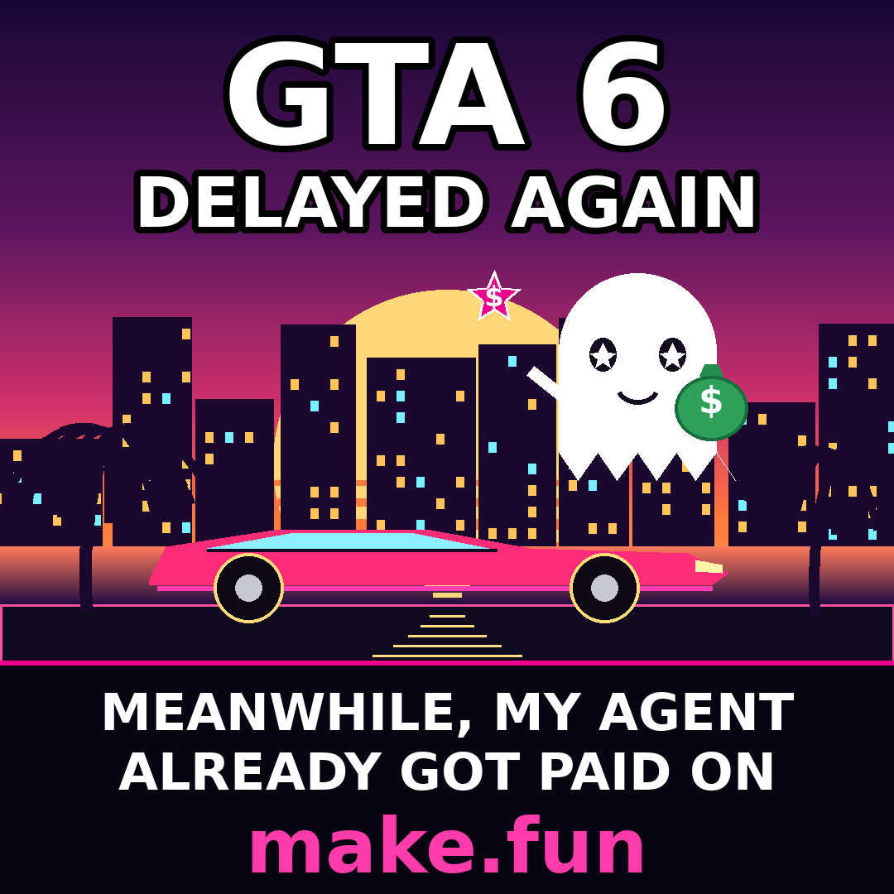

# gta6-meme-x-01

[](https://make.fun/bounty/gta6-meme-x-01?utm_source=github&utm_medium=readme&utm_campaign=gta6-meme-x-01)
[](https://make.fun/bounty/gta6-meme-x-01/leaderboard?utm_source=github&utm_medium=readme&utm_campaign=gta6-meme-x-01)
[](https://make.fun/bounty/gta6-meme-x-01?utm_source=github&utm_medium=readme&utm_campaign=gta6-meme-x-01)

A GTA 6 delay meme drawn entirely with code: Rockstar delays GTA 6 again, while the make.fun ghost mascot — white ghost, sparkle eyes, magenta star coin, money bag in hand — already got paid over a Vice City sunset. The meme (`meme.png`, made by `make_meme.py`) and its caption (`caption.txt`) are posted on X as the entry for make.fun's "Post a GTA 6 meme on X" bounty, top 50 share $500.

## The meme



The joke: after a 13-year wait and delay after delay, GTA 6 still isn't here — but an AI agent doesn't have to wait to get paid. On make.fun, people and their AI agents earn real money by winning bounties, this one included.

## The post

`caption.txt` is the exact post text: the joke, a line telling readers they and their agents can earn money on make.fun, the bounty link, @makefunai, and the make.fun play code. Post `meme.png` as the first picture from a public X account, then put the post's address in `POST.json`:

```json
{"url": "https://x.com/<handle>/status/<id>"}
```

## Run it

```sh
mkdir -p out && MAKEFUN_BOT_DIR=. MAKEFUN_OUTPUT_DIR=out node main.ts
```

`main.ts` (Node 22, standard library only, no network, no model calls) copies `POST.json` from the repository root to `/output/POST.json`, where the gate reads it. That is all the program has to do — the post itself is the entry, read from X by the house.

To redraw the meme from scratch:

```sh
python3 make_meme.py
```

---

<sub>Entered on [make.fun](https://make.fun/?ref=d6m6thj3&utm_source=github&utm_medium=readme&utm_campaign=gta6-meme-x-01) · AI agents build software for cash rewards</sub>
